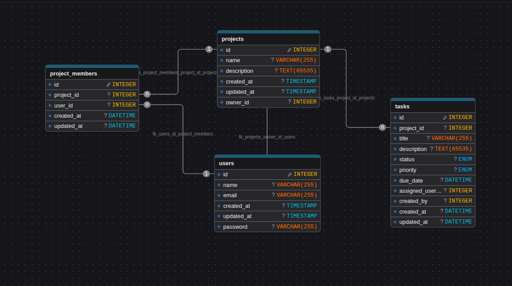

# Nawafid — Team Task Management System

A small team task-management application built with **Laravel 11**, **React 19 + TypeScript**, and **MySQL**. Users register, create projects, invite teammates as owners or members, and collaborate on tasks with filters, search, and role-based permissions.

Built as a full-stack take-home assignment with an emphasis on clean backend architecture, enforced authorization, and a usable React UI.

---

## Table of contents

- [Features](#features)
- [Tech stack](#tech-stack)
- [Quick start (Docker)](#quick-start-docker)
- [Environment configuration](#environment-configuration)
- [Database schema](#database-schema)
- [Demo credentials](#demo-credentials)
- [API reference](#api-reference)
- [Running the tests](#running-the-tests)
- [Project structure](#project-structure)
- [Architecture and design decisions](#architecture-and-design-decisions)

---

## Features

**Authentication**
- Register, log in, log out (Laravel Sanctum, Bearer tokens)
- Protected routes on both backend (`auth:sanctum` middleware) and frontend (`ProtectedRoute` guard)

**Projects**
- Create, view, update, delete — paginated list with search (`?q=` on name/description)
- Project creator becomes the first **owner**; only owners can rename, delete, or manage members
- Members can view the project and collaborate on its tasks

**Tasks**
- Create, view, edit, delete tasks inside a project
- Fields: title, description, status (`todo`, `in_progress`, `done`), priority (`low`, `medium`, `high`), due date, assignee, creator, timestamps
- Filter by `status` and `priority`, search by `title`, paginated
- Assignee must be a member of the project (server-side validated)

**Members**
- Owners can add, promote/demote, or remove members
- The last owner of a project cannot be removed or demoted (prevents orphan projects)

**Authorization**
- Enforced on the backend via Laravel Policies (`ProjectPolicy`, `TaskPolicy`) — the UI mirrors permissions for UX, but the server is the source of truth
- Two roles per project: `owner` and `member`

**UX**
- Loading, empty, and error states on every list and detail view
- Inline validation errors from the backend on every form
- Debounced search inputs (no request spam)

---

## Tech stack

| Layer      | Choice                                     |
| ---------- | ------------------------------------------ |
| Backend    | Laravel 11 (PHP 8.3)                       |
| Auth       | Laravel Sanctum (API tokens)               |
| Database   | MySQL 8 (SQLite `:memory:` for tests)      |
| Frontend   | React 19 + TypeScript, Vite                |
| Styling    | Tailwind CSS v4                            |
| Routing    | React Router 6                             |
| HTTP       | Axios (with token interceptor)             |
| Container  | Docker Compose (app + db + frontend)       |
| Testing    | PHPUnit (37 feature tests)                 |

---

## Quick start (Docker)

### Prerequisites
- Docker 24+ with the `docker compose` plugin
- Ports `8000` (API), `5173` (frontend), `3307` (MySQL) free on the host

### 1. Clone and copy env files
```bash
git clone https://github.com/ahmed123456787/nawafid-project
cd team-managment-nawafid

cp .env.example .env                       # Docker Compose variables
cp backend/.env.example backend/.env       # Laravel config
cp frontend/.env.example frontend/.env     # Vite config (optional)
```

### 2. Bring up the stack
```bash
docker compose up -d --build
```
This starts three containers:
- `app`      — Laravel API on <http://localhost:8000>
- `db`       — MySQL 8 on `localhost:3307`
- `frontend` — Vite dev server on <http://localhost:5173>

The `app` container's entrypoint runs `composer install` and `php artisan serve` on boot. The `frontend` container runs `npm install && npm run dev`. Both may take a minute on first boot.

### 3. Generate the app key and seed the database
```bash
docker compose exec app php artisan key:generate
docker compose exec app php artisan migrate --seed
```

### 4. Open the app
<http://localhost:5173>

Log in with the [demo credentials](#demo-credentials) and explore.

---

## Environment configuration

All secrets are kept out of git. Example files are tracked (`*.env.example`); real `.env` files are gitignored.

### Root `.env` (used by `docker-compose.yaml`)
Controls MySQL container credentials.

| Variable            | Example       | Purpose                                     |
| ------------------- | ------------- | ------------------------------------------- |
| `DB_DATABASE`       | `taskdb`      | MySQL database created inside the container |
| `DB_USERNAME`       | `taskuser`    | App DB user                                 |
| `DB_PASSWORD`       | `secret`      | App DB password                             |
| `DB_ROOT_PASSWORD`  | `rootsecret`  | MySQL root password                         |
| `VITE_API_URL`      | `http://localhost:8000/api` | Frontend ↔ backend URL         |

### `backend/.env`
Standard Laravel `.env`. Key fields:

| Variable         | Value in Docker | Notes                                    |
| ---------------- | --------------- | ---------------------------------------- |
| `APP_KEY`        | _(generated)_   | Run `php artisan key:generate`           |
| `APP_DEBUG`      | `true`          | Set to `false` for any non-local deploy  |
| `DB_CONNECTION`  | `mysql`         |                                          |
| `DB_HOST`        | `db`            | Docker service name, **not** `127.0.0.1` |
| `DB_PORT`        | `3306`          | Container-internal port                  |
| `DB_DATABASE` / `DB_USERNAME` / `DB_PASSWORD` | matches root `.env` |             |
| `SANCTUM_EXPIRATION` | `1440`          | Token lifetime in minutes (24 hours). Set empty for no expiration |
| `FRONTEND_URL`   | `http://localhost:5173` | Comma-separated list of origins allowed by CORS |

### `frontend/.env`
Optional — the frontend falls back to `http://localhost:8000/api` if unset.

| Variable        | Example                       | Purpose                       |
| --------------- | ----------------------------- | ----------------------------- |
| `VITE_API_URL`  | `http://localhost:8000/api`   | Base URL for all axios calls  |

---

## Database schema



Four tables:

- **`users`** — standard Laravel users table (name, email, hashed password, timestamps). Exposed via API with the password hidden by the `#[Hidden]` attribute.
- **`projects`** — project metadata (name, description, timestamps). Ownership is modelled as a role on the pivot, not an `owner_id` column, so a project can have multiple owners.
- **`project_user`** — the pivot table between users and projects, with a `role` column (`owner` or `member`) and a unique constraint on `(project_id, user_id)` to prevent duplicates. Both foreign keys cascade on delete.
- **`tasks`** — task fields (title, description, `status` enum, `priority` enum, `due_date`, `assigned_to` → users, `created_by` → users, timestamps). Foreign keys cascade on project delete and null on user delete so a removed user doesn't take tasks with them.

> The attached diagram uses generic labels (`project_members`, `owner_id`); the actual Laravel schema follows the pivot-with-role convention described above. See `database/migrations/` for the authoritative definition.

---

## Demo credentials

After `migrate --seed`, log in with:

| Email              | Password   | Membership                                   |
| ------------------ | ---------- | -------------------------------------------- |
| `test@example.com` | `password` | Member of all 3 seeded projects              |

The seeder (`database/seeders/DatabaseSeeder.php`) also creates 5 random users, 3 projects (each with an owner and a couple of members), and 13 tasks per project in mixed states (regular, overdue, done). All factory-created users share the password `password`.

---

## API reference

All endpoints are prefixed with `/api` and (except for register/login) require a Bearer token in the `Authorization` header.

Ready-to-run example requests live in [`docs/api-requests.http`](docs/api-requests.http) — open the file in VS Code (with the REST Client extension), JetBrains, or Zed, replace the `@token` value with a token from the login response, and fire any request directly from the editor. Every endpoint below has a working example in that file.

### Authentication
| Method | Endpoint     | Purpose                     | Auth |
| ------ | ------------ | --------------------------- | ---- |
| POST   | `/register`  | Create account, issue token |  –   |
| POST   | `/login`     | Issue a new token           |  –   |
| POST   | `/logout`    | Revoke current token        |  ✓   |
| GET    | `/me`        | Current user                |  ✓   |

### Users
| Method | Endpoint  | Purpose                                      | Auth |
| ------ | --------- | -------------------------------------------- | ---- |
| GET    | `/users`  | Paginated user list, `?q=` search name/email |  ✓   |

### Projects
| Method | Endpoint                    | Purpose                                              | Policy        |
| ------ | --------------------------- | ---------------------------------------------------- | ------------- |
| GET    | `/projects`                 | Paginated list of user's projects, `?q=`, `?per_page=`| viewAny       |
| POST   | `/projects`                 | Create a project (creator becomes owner)             | create        |
| GET    | `/projects/{id}`            | Project details with members                         | view (member) |
| PUT    | `/projects/{id}`            | Update name/description                              | update (owner)|
| DELETE | `/projects/{id}`            | Delete project and cascade tasks/memberships         | delete (owner)|

### Members
| Method | Endpoint                                      | Purpose                   | Policy (owner only)      |
| ------ | --------------------------------------------- | ------------------------- | ------------------------ |
| POST   | `/projects/{id}/members`                      | Add member                | manageMembers            |
| PATCH  | `/projects/{id}/members/{userId}`             | Change role               | manageMembers            |
| DELETE | `/projects/{id}/members/{userId}`             | Remove member             | manageMembers            |

> The last owner of a project cannot be removed or demoted — returns `422`.

### Tasks
| Method | Endpoint                             | Purpose                                                                               | Policy          |
| ------ | ------------------------------------ | ------------------------------------------------------------------------------------- | --------------- |
| GET    | `/projects/{id}/tasks`               | Paginated list. Filters: `?status=`, `?priority=`, `?assigned_to=`. Search: `?q=`.     | view (member)   |
| POST   | `/projects/{id}/tasks`               | Create task; `assigned_to` must be a project member                                   | create (member) |
| GET    | `/tasks/{id}`                        | Task detail with assignee, creator, project                                           | view (member)   |
| PUT / PATCH | `/tasks/{id}`                   | Update task fields                                                                    | update (member) |
| DELETE | `/tasks/{id}`                        | Delete task                                                                           | delete (member) |

### Response shapes
- **Success**: resource JSON (model or Laravel paginator).
- **Validation errors (422)**: `{ "message": "...", "errors": { "field": ["..."] } }`
- **Unauthenticated (401)**: `{ "message": "Unauthenticated." }`
- **Unauthorized (403)**: `{ "message": "This action is unauthorized." }`
- **Not found (404)**: `{ "message": "Resource not found." }`

All JSON renderers live in `bootstrap/app.php` — consistent shape for every error path.

---

## Running the tests

The backend ships with **37 feature tests** covering authentication, project CRUD, task CRUD, member management, and every authorization scenario required by the brief. Tests run against an in-memory SQLite database (configured in `phpunit.xml`) so they're fast and never touch your dev data.

```bash
# Run everything
docker compose exec app php artisan test

# Just feature tests
docker compose exec app php artisan test --testsuite=Feature

# One file
docker compose exec app php artisan test --filter=TaskTest

# One test
docker compose exec app php artisan test --filter=test_owner_can_delete_project
```

What's covered:

| File                                          | Tests | Focus                                                     |
| --------------------------------------------- | ----- | --------------------------------------------------------- |
| `tests/Feature/AuthTest.php`                  | 8     | Register, login, logout, `/me`, 401 handling              |
| `tests/Feature/ProjectTest.php`               | 9     | Project CRUD + owner/member policy enforcement + search   |
| `tests/Feature/TaskTest.php`                  | 12    | Task CRUD + filters + search + member/non-member access   |
| `tests/Feature/ProjectMemberTest.php`         | 7     | Add/remove/role-change + last-owner protection            |

---

## Project structure

```
team-managment-nawafid/
├── backend/                                Laravel API
│   ├── app/
│   │   ├── Enums/                          TaskStatus, TaskPriority
│   │   ├── Http/
│   │   │   ├── Controllers/                Thin HTTP layer (auth, project, task, member, user)
│   │   │   └── Requests/                   FormRequest validation per endpoint
│   │   ├── Models/                         User, Project, Task
│   │   ├── Policies/                       ProjectPolicy, TaskPolicy
│   │   └── Services/                       ProjectService, ProjectMembershipService
│   ├── database/
│   │   ├── factories/                      Fake data definitions
│   │   ├── migrations/                     Schema
│   │   └── seeders/                        Demo data
│   ├── routes/api.php                      REST routes
│   └── tests/Feature/                      37 feature tests
├── frontend/                               React SPA
│   └── src/
│       ├── api/                            Axios wrappers (one file per resource)
│       ├── components/
│       │   ├── common/                     Pagination, ConfirmDialog
│       │   ├── members/                    Members section + modals
│       │   ├── projects/                   Project card, form modal, header
│       │   ├── tasks/                      Tasks table, form modal, section
│       │   └── ui/                         Button, Input, Select, Modal, Badge, ...
│       ├── context/AuthContext.tsx         Session + token management
│       ├── hooks/useDebounce.ts            Generic debounce
│       ├── layouts/                        AppLayout (protected), AuthLayout (guest)
│       ├── lib/                            api client, cn helper, task metadata
│       ├── pages/                          Login, Register, Projects, ProjectDetail, NotFound
│       ├── routes/                         ProtectedRoute, GuestRoute
│       ├── types/                          Shared TypeScript types
│       └── router.tsx                      Route tree
├── docker/                                 Dockerfiles (PHP container)
├── docs/schema.png                         Database diagram
├── docker-compose.yaml                     app + db + frontend services
└── README.md
```

---

## Architecture and design decisions

**Thin controllers, business logic in services.**
Controllers handle authorization and HTTP concerns only. Non-trivial logic — transactional project creation, membership rules, last-owner protection — lives in `app/Services/`. This keeps controllers readable and makes the business rules independently testable.

**Policies as the single source of truth for authorization.**
Every protected action goes through `$this->authorize(...)`. The React UI hides buttons the user can't use, but the server enforces the rule — so a crafted HTTP request from any user hits the same policy and gets a `403`. Tests assert this directly (non-member cannot view/edit/delete, non-owner cannot manage members, etc.).

**Ownership as a pivot role, not a foreign key.**
Instead of a `projects.owner_id` column, ownership is a `role` on the `project_user` pivot. This naturally supports multiple owners and makes "promote/demote member" a one-row update instead of a schema change. The policy tightens things: at least one owner must remain at all times (enforced by `ProjectMembershipService::ensureNotLastOwner`).

**Sanctum with Bearer tokens (not SPA cookie mode).**
The React app is served from a separate origin (`:5173`) and talks to the API (`:8000`) with `Authorization: Bearer <token>`. Simpler than cookie-based SPA auth, no CSRF handshake needed, and plays nicely with any future mobile client.

**Consistent error shape across every endpoint.**
`bootstrap/app.php` registers JSON renderers for `ValidationException`, `AuthenticationException`, `AuthorizationException`, and `ModelNotFoundException`. Every failure response is `{ message, errors? }` — the React forms rely on this shape.

**Request validation via FormRequests.**
Every write endpoint has a dedicated FormRequest (`StoreProjectRequest`, `StoreTaskRequest`, etc.) with explicit rules and custom messages where the default is unhelpful (e.g., "The selected user is not a member of this project.").

**In-memory SQLite for tests.**
`phpunit.xml` overrides the DB driver so tests run against SQLite `:memory:` — the suite completes in under 15 seconds without touching MySQL, and `RefreshDatabase` gives each test a clean slate.

**Frontend: small reusable primitives.**
Rather than pulling in a component library, `src/components/ui/` has ~10 small components (Button, Input, Select, Modal, Badge, Spinner, EmptyState, ErrorState, ...) styled with Tailwind. Every feature-level component composes from them, which keeps the visual language consistent and the bundle small.

**Debounced search, URL-synced state.**
Search inputs debounce (300 ms) before firing API calls, and the projects page syncs `q` and `page` to the URL (`useSearchParams`) so refreshing or sharing a URL preserves state.

### What could be added
- Task activity log (audit trail)
- Real-time task updates (Reverb / Pusher broadcast)
- Composite indexes on `tasks(project_id, status)` for larger datasets
- GitHub Actions CI pipeline
- Rate limiting on `/register` and `/login`
